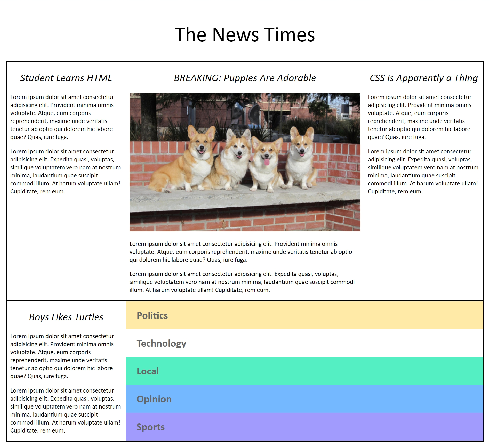

# HTML & CSS Layout Practice

A small frontend practice project for working with HTML structure and CSS styling.



## Run locally

Clone this repository and open `index.html` in your browser. No dependency installation or build step is required.

```bash
git clone https://github.com/rkodirkhonov/HTML-CSS-1.git
cd HTML-CSS-1
```

## Files

- `index.html` — page markup.
- `styles/style.css` — page styling.
- `images/picture.jpg` — existing layout preview.

## Next improvements

- [ ] Check layout behavior at mobile, tablet, and desktop widths.
- [ ] Review semantic HTML and keyboard navigation.
- [ ] Document the layout decisions with before-and-after screenshots.

This repository is a fundamentals exercise rather than a full application.
